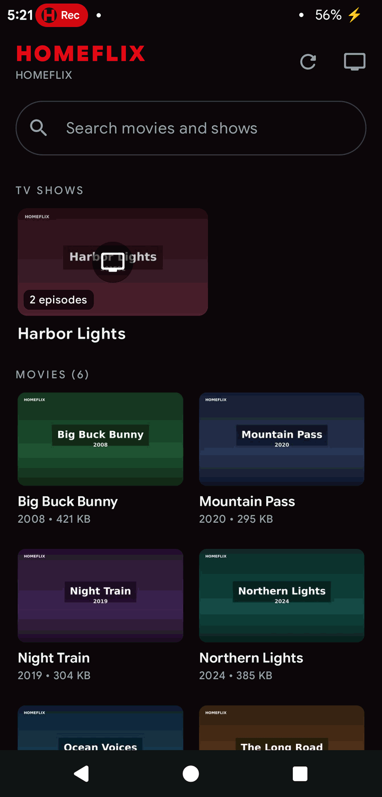
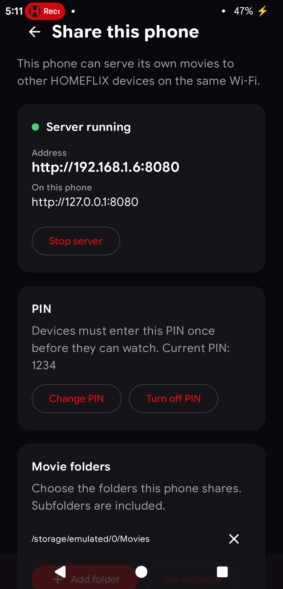

# HOMEFLIX

Watch the movies on your Windows PC, Mac or Linux computer from your iPad, iPhone, Android phone or TV, over your home Wi-Fi. No account, no internet upload, no subscription.

**Website and download: [kprakz.github.io/homeflix](https://kprakz.github.io/homeflix/)**

> **This fork** adds a native Android app. The Windows, macOS and Linux installers are still published by the upstream project; Android builds and release files come from [this fork](https://github.com/VigneshVijayK/homeflix).

## Two ways to use HOMEFLIX

HOMEFLIX has two sides: the **computer** that holds your movies, and the **screen** that plays them.
Most people use the computer as the server and watch from a phone, tablet or TV. The Android app can
also work the other way around and share the phone's own videos.

<table>
  <tr>
    <td align="center" width="50%">
      <br>
      <strong>Client mode</strong><br>
      Browse and watch the movies stored on your computer.
    </td>
    <td align="center" width="50%">
      <br>
      <strong>Server mode</strong><br>
      Share this phone's videos with other HOMEFLIX devices.
    </td>
  </tr>
</table>

### Client mode: watch your computer's movies

Install HOMEFLIX on the computer that has your movies and choose your movie folder. Then open the
Android app or the address shown in the HOMEFLIX window on your phone, tablet or TV. The app finds
the computer automatically; on iPhone, iPad and smart TVs, open the address in a browser.

This is the normal setup. Your movies stay on the computer, and every screen plays them over your
home Wi-Fi. Resume positions, series, auto-play next episode, audio tracks, subtitles and HEVC
fallback all work in this mode.

### Server mode: share this phone's videos

The Android app can also serve videos stored on the phone. Open **Share this phone's videos**, choose
the folders to share, and give other devices the address and PIN shown on the screen. Other HOMEFLIX
devices connect exactly as they connect to a computer.

This is useful when the computer is off, when you are travelling, or when the videos are already
downloaded on the phone.

## Start here

| Your device | What to do |
| --- | --- |
| Windows PC | [Install on Windows](#install-on-windows-5-minutes-one-time) |
| Mac | [Install on a Mac](#install-on-a-mac) |
| Linux computer | [Install on Linux](#install-on-linux) |
| Android phone, tablet or TV | [Install the Android app](#install-on-android) |
| iPhone, iPad or smart TV | Nothing to install: [open the address in a browser](#watch) |

**Three steps for most people:**

1. Install HOMEFLIX on the computer that has your movies.
2. Choose the folder where your movies are.
3. Open the address shown in HOMEFLIX on your phone or TV, or let the Android app find the computer.

**What you need:** a computer (Windows 10/11, macOS 12 or newer, or Linux), your movie files, and a
phone, tablet or TV on the same home Wi-Fi. No account, subscription or internet upload is needed.

## What's new in Android 1.4.5

Android 1.4.5 refreshes the app's look and makes server mode clearer.

- **Smoother, more tactile controls.** Buttons, cards and player controls now bounce subtly when
  pressed.
- **Clearer server mode.** The connect screen has a dedicated **Share phone's videos (Server Mode)**
  button with a green **ON** badge while the server is running.
- **Better server screen.** Server Mode shows its status at a glance, only starts when you enable it,
  keeps folder controls simple, and refreshes file access when you return to the app.
- **Polished screens.** The player, library, PIN, and QR scanner screens share the same buttons and
  tap feedback.
- **Layout fixes.** The QR scanner stays clear of system navigation, and long connect-screen labels
  no longer clip.

Download the signed APK or app bundle from the
[Android 1.4.5 release](https://github.com/VigneshVijayK/homeflix/releases/tag/android-v1.4.5).

---

## Install on a Mac

1. **[Download HOMEFLIX for Mac](https://kprakz.github.io/homeflix/#download)**. Choose **Apple Silicon** for Macs with an M1–M4 chip, or **Intel**. (Apple menu → About This Mac shows which you have.) Requires macOS 12 or later.
2. Open the downloaded `.dmg` and drag **HOMEFLIX** onto **Applications**.
3. Open HOMEFLIX from Applications. The first time, macOS says it can't verify the app. Click **Done**, open System Settings → **Privacy & Security**, scroll down and click **Open Anyway**. You only do this once. (HOMEFLIX isn't notarized by Apple, which needs a paid developer account.)
4. Click **Choose your movies folder**.
5. When macOS asks whether HOMEFLIX may **accept incoming network connections**, click **Allow**. Your phone and TV can't connect otherwise.

HOMEFLIX then lives in the menu bar at the top right of the screen. Everything else below works the same as on Windows.

## Install on Linux

### Which file?

| Your computer | Download |
|---|---|
| Ubuntu, Debian, Mint, Pop!_OS (64-bit PC) | `HOMEFLIX-<version>-linux-amd64.deb` (recommended) |
| Fedora, Arch, openSUSE or any other distro (64-bit PC) | `HOMEFLIX-<version>-linux-x86_64.AppImage` |
| Raspberry Pi 4/5 (64-bit OS) or another ARM computer | `HOMEFLIX-<version>-linux-arm64.deb` or `-arm64.AppImage` |

Not sure if it's a PC or ARM? Run `uname -m`: `x86_64` means 64-bit PC, `aarch64` means ARM.

Download it from **[the website](https://kprakz.github.io/homeflix/#download)** or the [latest release](https://github.com/kprakz/homeflix/releases/latest).

### Option A: the .deb (Ubuntu, Debian, Mint)

Open a terminal in the folder you downloaded it to (usually `cd ~/Downloads`) and run these one at a time. Type your password when asked; nothing shows while you type.

```bash
sudo apt update
sudo apt install libasound2t64 || sudo apt install libasound2
sudo apt install ./HOMEFLIX-*-linux-amd64.deb
```

- The second line adds the sound library HOMEFLIX needs. Some minimal systems (servers, WSL) don't have it, and HOMEFLIX 1.4.0 doesn't install it by itself. If it's already there, the command just says so.
- Keep the `./` in the last line: it tells apt to use the file in this folder.
- At the end you may see `N: Download is performed unsandboxed as root…`. That's only a note, and the install worked.

### Option B: the AppImage (any distro, nothing to install)

```bash
chmod +x HOMEFLIX-*.AppImage
./HOMEFLIX-*.AppImage
```

Or right-click it → Properties → **Allow executing as program**, then double-click it. If it won't start on Ubuntu 22.04 or later, run `sudo apt install libfuse2t64` (or `libfuse2`) once and try again.

### Start HOMEFLIX

- Open **HOMEFLIX** from your apps menu, or type `homeflix &` in a terminal (.deb).
- Click **Choose your movies folder** and pick the folder with your films. Sub-folders are included.
- **Don't run it with `sudo`.** It doesn't need admin rights.
- HOMEFLIX keeps running in the system tray when you close the window. On GNOME (Ubuntu's default desktop), you may need the *AppIndicator* extension to see the icon. To quit, use the tray icon or run `pkill homeflix`.

### Let your phone and TV in (if you use a firewall)

Most desktop installs have no firewall turned on, so skip this unless your phone can't connect. With ufw (Ubuntu):

```bash
sudo ufw allow from 192.168.0.0/16 to any port 8080 proto tcp
```

This only opens HOMEFLIX's port to your home network. If the HOMEFLIX window shows a different port, use that number instead of `8080`.

### Running it in WSL (Windows Subsystem for Linux)

It installs and runs the same way, and the window appears on your Windows desktop. But by default **phones and TVs can't reach it**: WSL sits on a private network inside Windows (its address starts with `172.`). **On a Windows PC, the Windows version is the easy choice.** If you want the Linux copy anyway, the steps below let your phone in.

#### Watch from your phone when HOMEFLIX runs in WSL

Needs **Windows 11 version 22H2 or later**; Windows 10 doesn't have this option. These steps change Windows networking settings and add a firewall rule, and they're easy to undo (see the end).

1. **Quit the Windows HOMEFLIX** if it's running (tray icon → Quit HOMEFLIX). Both copies would want port 8080.
2. **Turn on mirrored networking.** Open Notepad and paste:
   ```
   [wsl2]
   networkingMode=mirrored
   ```
   Save it as `C:\Users\<you>\.wslconfig`, with **Save as type: All files**. Otherwise Notepad saves it as `.wslconfig.txt` and WSL ignores it. In File Explorer, turn on View → Show → File name extensions to check.
3. **Open PowerShell as Administrator**: Start → type *PowerShell* → right-click **Windows PowerShell** → **Run as administrator** → Yes. Check two things:
   - The window title starts with **Administrator:**. If not, you get "Access is denied".
   - The prompt starts with **`PS`** (`PS C:\Users\you>`). If it's just `C:\Users\you>`, it's Command Prompt and you get "is not recognized". Type `powershell` and press Enter to switch; the admin rights carry over.
4. **Restart WSL and let your phone through**, in that Administrator PowerShell:
   ```powershell
   wsl --shutdown
   ```
   ```powershell
   New-NetFirewallHyperVRule -Name HOMEFLIX-WSL -DisplayName "HOMEFLIX in WSL" -Direction Inbound -VMCreatorId '{40E0AC32-46A5-438A-A0B2-2B479E8F2E90}' -Protocol TCP -LocalPorts 8080 -Profiles Private -RemoteAddresses 192.168.0.0/16
   ```
   The second command prints a summary ending in `EnforcementStatus : OK`. It only opens HOMEFLIX's port, only on networks Windows calls **Private** (your home Wi-Fi), and only to home addresses (192.168.x.x). On café or hotel Wi-Fi, which Windows treats as Public, it stays closed. If your home network uses 10.x.x.x addresses, put `10.0.0.0/8` instead of `192.168.0.0/16`. Your home Wi-Fi must be set to Private: Settings → Network & internet → Wi-Fi → your network → **Private network**.
5. **Start HOMEFLIX in Ubuntu** (`homeflix &`). Running `hostname -I` in Ubuntu should now show your PC's Wi-Fi address (like `192.168.1.57`) instead of `172.…`.
6. **On your phone**, open `http://<that address>:8080`.

On the PC itself, use `http://localhost:8080`. In mirrored mode, Windows can't reach its own Wi-Fi address inside WSL, so that address may time out on the PC even though phones work.

**Set up once, and it stays.** Nothing here runs or reverts when you open or close HOMEFLIX. The firewall rule stays in Windows, and that's fine: while HOMEFLIX is closed nothing answers on port 8080, so phones just can't connect, and when you open it again they connect straight away. Mirrored networking applies to all of WSL, not just HOMEFLIX: Ubuntu shares your PC's Wi-Fi address, and everything else stays blocked by WSL's firewall.

Made the rule earlier without the `-Profiles` and `-RemoteAddresses` parts? Tighten it in an Administrator PowerShell:
```powershell
Set-NetFirewallHyperVRule -Name HOMEFLIX-WSL -Profiles Private -RemoteAddresses 192.168.0.0/16
```

**To undo it all** (only if you stop using HOMEFLIX in WSL for good):
1. In an Administrator PowerShell, remove the firewall rule:
   ```powershell
   Remove-NetFirewallHyperVRule -Name HOMEFLIX-WSL
   ```
2. Delete the file `C:\Users\<you>\.wslconfig`.
3. Run `wsl --shutdown` (a normal PowerShell is fine). WSL is back exactly as before.

Everything else below works the same as on Windows.

## Install on Windows (5 minutes, one time)

### 1. Download and run the installer
**[⬇ Download HOMEFLIX for Windows](https://kprakz.github.io/homeflix/#download)**, then double-click the downloaded `HOMEFLIX-Setup-<version>.exe`.

Requires Windows 10 or 11 (64-bit).

> **"Windows protected your PC"?** This shows up for new apps that aren't from a big publisher. Click **More info**, then **Run anyway**.

Follow the installer. It puts HOMEFLIX on your Desktop and in the Start menu, and opens it when it finishes. No admin password is needed.

### 2. Choose your movies folder
Click **Choose your movies folder** and pick the folder where your movies are, for example `Downloads` or `Videos`. Sub-folders are included, and you can add more folders any time.

### 3. Let your phone through Windows Firewall (if HOMEFLIX asks)
HOMEFLIX checks Windows Firewall and shows a box at the top of its window if something needs doing:
- **Your Wi-Fi is set to Public:** click **Open network settings** → your Wi-Fi → **Properties** → **Private network**. Only do this for your **home** Wi-Fi, never for café, hotel or airport Wi-Fi.
- **HOMEFLIX isn't allowed on home networks yet:** click **Allow on home networks** and say **Yes** when Windows asks.

> The first time HOMEFLIX starts, Windows may ask *"Allow HOMEFLIX to communicate on these networks?"* It ticks whichever network type you're on at that moment. If your Wi-Fi was Public then, HOMEFLIX ends up allowed only on Public networks, and stops working once you switch the Wi-Fi to Private. The **Allow on home networks** button fixes that.

---

## Install on Android

This fork includes a native Android app for phones, tablets, Android TV, Google TV and Fire TV. It
connects to the same HOMEFLIX computer as the browser and has the same features: resume positions and
start over, series and auto-play next episode, audio languages, subtitles, remembered volume boost,
and HEVC fallback.

The 1.4.5 app refreshes the interface with responsive buttons and cards, a clearer connect screen,
and a Server Mode screen that shows whether the phone is sharing and only starts when you ask it to.
The QR scanner also stays clear of the system navigation bar, and long labels no longer clip.

The phone can also act as the server; see [Server mode](#server-mode-share-this-phones-videos) above.
Tap **Share this phone's videos** on the connect screen and other HOMEFLIX devices on the same Wi-Fi
can watch it. You choose the shared folders with the system folder picker, and the PIN can be changed
(4 to 8 digits) or turned off, just like the desktop app. The embedded server is the same `server.js`
as the desktop app; see [`android/README.md`](android/README.md#server-mode-on-the-phone) for details.

### Install the APK

1. Download **`HOMEFLIX-<version>.apk`** from [this fork's latest release](https://github.com/VigneshVijayK/homeflix/releases/latest)
   and open it. Android asks once whether to allow installing apps from this source; allow it, then
   tap **Install**.
2. Open **HOMEFLIX**. It looks for your computer on the same Wi-Fi and lists computers as it finds
   them. If yours does not appear, wait for the scan to finish or tap the refresh button. Older
   computers that do not announce themselves are found by the local network scan.
3. Choose your computer. You can also tap **Scan QR code** to use the camera, tap **Import from
   gallery** to pick a screenshot or photo of the QR code, or type the address shown (for example
   `192.168.1.57:8080`).
4. If the computer has a PIN, enter it once. The app remembers the computer and the PIN.
5. To reload the movie list later, tap the refresh button at the top of the library. It spins while
   it reads the library again.

If the app still cannot find the computer, make sure both are on the same Wi-Fi and type the
computer's address by hand. A firewall on the computer can also block the connection; see
[Troubleshooting](#troubleshooting).

Requires **Android 7.0 or newer**. The same APK works on Android TV, Google TV and Fire TV; sideload it
and it appears under your apps. If no release is available yet, build it from source below or run the
**Android build** GitHub Actions workflow and download the `HOMEFLIX-android` artifact.

### Build from source

Requirements: JDK 17 or newer, Android SDK 36 (`platforms;android-36` and
`build-tools;36.0.0`), NDK `28.0.13004108` and CMake `3.22.1`. Point `ANDROID_HOME` at the SDK, or
create `android/local.properties` with `sdk.dir=/path/to/android-sdk` (that file is gitignored).

Server mode also needs the Node.js and FFmpeg Android binaries, which are not committed. Download and
copy them in once with `android/scripts/fetch-native.sh` (paths and layout are in
[`android/README.md`](android/README.md#build)).

```bash
cd android
./gradlew :app:assembleDebug
adb install -r app/build/outputs/apk/debug/app-debug.apk
```

For Android TV / Google TV / Fire TV over ADB:

```bash
adb connect <tv-ip>:5555
adb install -r app/build/outputs/apk/debug/app-debug.apk
```

Useful checks:

```bash
./gradlew :app:testDebugUnitTest :app:lintDebug
```

The app version and `versionCode` come from the root `package.json` (`1.4.5` → `10405`), so bumping
the desktop version also bumps Android. See [`android/README.md`](android/README.md) for the project
layout and Play publishing steps.

### Signed releases and GitHub Actions

Create a keystore once and set the `ANDROID_KEYSTORE_PATH`, `ANDROID_KEYSTORE_PASSWORD`,
`ANDROID_KEY_ALIAS` and `ANDROID_KEY_PASSWORD` environment variables (or use
`keystore.properties` inside `android/`). Then build:

```bash
cd android
./gradlew :app:assembleRelease :app:bundleRelease
```

Outputs:

- `app/build/outputs/apk/release/app-release.apk` for GitHub Releases
- `app/build/outputs/bundle/release/app-release.aab` for Google Play

`.github/workflows/android.yml` builds and tests the app on pushes and pull requests, attaches a
signed APK/AAB to published GitHub releases, and optionally uploads the AAB to Google Play's internal
track. Without keystore secrets it uploads a debug APK instead. Configuration details are in
[`android/README.md`](android/README.md).

## Watch

1. Connect your iPhone, iPad, Android phone or TV to the **same Wi-Fi** as the laptop.
2. **Scan the QR code** in the HOMEFLIX window with the camera, or type the address shown (for example `http://192.168.1.57:8080`) into the browser.
3. Pick a movie and press Play.

### iPhone and iPad
Open the address in **Safari**. Tap **Share → Add to Home Screen** to get a HOMEFLIX app icon.

### Android phones and tablets
Open the address in **Chrome**. Tap **⋮ → Add to Home screen** (or **Install app**) to get a HOMEFLIX app icon. Videos go full-screen in landscape, and the phone's back button works as you'd expect.

### Smart TVs
Open your TV's web browser, such as Samsung Internet, LG Web Browser, or a browser app on Android TV / Google TV / Fire TV, and type the address.

| Remote button | What it does |
|---|---|
| Arrows / OK | Move around and choose |
| Back | Go back, or leave the movie |
| OK (while watching) | Pause / play |
| Left / Right (while watching) | Skip back / forward 10 seconds |
| Up / Down (while watching) | Show the controls: subtitles, skip, play/pause |

If HOMEFLIX doesn't switch to TV controls on its own, add `?tv=1` to the end of the address once, for example `http://192.168.1.57:8080/?tv=1`. Your TV remembers it.

From an iPhone or iPad you can also **AirPlay** to an Apple TV or an AirPlay-compatible TV.

### Audio language and subtitles
Movies with several audio languages (for example Tamil, Telugu, Hindi and English in one file) get a language button in the player:
- **iPhone, iPad, Android, laptop:** tap **🔊 Tamil** (or whichever language is playing) at the top right of the player. On iPhone/iPad, leave full screen first.
- **TV:** press **Up**, then choose **Audio**.

The movie continues at the same point in the new language. Each device remembers your choice for that movie, and the last language you picked becomes your default. Choose English once, and other multi-language movies start in English on that device.

Subtitles inside the movie, or a `.srt` / `.vtt` file next to it with the same name, appear in the player's subtitle menu (on a TV: **Up → Subtitles**).

**Tips**
- Each device remembers where you stopped and shows those movies under **Continue Watching**. To watch from the beginning instead, choose **Start over**: next to **Resume** on the home screen and in **More Info**, at the top of the player, or in the TV controls.
- **Too quiet?** Many films are mixed quietly for cinemas, and phones and TVs can't go above 100% the way VLC can. Turn on **Volume boost** in the player (top right; on a TV, press Up). It makes the sound about twice as loud on that device without distorting it, and the device remembers it. Turn it off for the original sound.
- TV shows named like `Show S01E05` are grouped into series, and the next episode plays automatically.

## Good to know

- **Keep the laptop awake and plugged in** while you watch. Nothing plays on the laptop itself: the movie plays on your device.
- **Closing the window doesn't stop HOMEFLIX.** It keeps running in the system tray, near the clock. Right-click the red **H** icon → **Quit HOMEFLIX** to stop it.
- **Start with Windows** in Settings makes HOMEFLIX start quietly when you sign in.
- **MKV files** are repackaged once into a format phones and TVs play. This usually takes seconds, or a few minutes for movies with Dolby audio.
- **Devices that can't play HEVC (x265)**, which includes many Android phones and TVs, get a version converted while you watch. It starts in a few seconds, and HOMEFLIX uses the laptop's Intel, NVIDIA or AMD graphics chip for this when it can. If you see sound but no picture, tap **Picture missing?** in the player.
- **Disk space:** converted copies are stored on the laptop. When space runs low, HOMEFLIX deletes the ones watched longest ago, keeping 2 GB free. **Settings → Free up space** removes them all, and they're made again when needed.
- **Files still downloading** show a *Downloading* badge and become playable when finished.

## Privacy and security

- **Home network only.** HOMEFLIX only answers devices on your own network (addresses like 192.168.x.x, 10.x.x.x and the computer itself). If your router forwards the port, or the computer has a public address, people on the internet are still turned away.
- **Optional PIN.** Without a PIN, anyone on your Wi-Fi can open HOMEFLIX. To stop that (shared flats, guests, an office), turn on **Settings → Require a PIN** and choose 4 to 8 digits. Each phone, tablet or TV asks for it once and remembers it. Changing or turning off the PIN signs every device out. After 5 wrong tries, each new try has to wait longer (30 seconds, then 1 minute, 2 minutes… up to an hour).
- **Only by its address.** The page must be opened by its address (like `http://192.168.1.20:8080`) or a home name (`mypc.local`), so a website can't reach your library through your browser.
- Nothing is uploaded, and there are no accounts or tracking.

## Uninstall

Settings → Apps → Installed apps → **HOMEFLIX** → Uninstall. This also removes HOMEFLIX's converted copies. Your own movie files are never touched.

## Troubleshooting

| Problem | Fix |
|---|---|
| Android app can't find my computer | Make sure both are on the same home Wi-Fi. Tap the refresh button and wait for the local network scan. If it still does not appear, type the computer's address shown in the HOMEFLIX window under **OR CONNECT BY HAND**. |
| Android app finds the computer but can't connect | Check that the computer's firewall allows HOMEFLIX on private/home networks and that the address and port are correct. |
| QR code won't scan or import | Use a clear, square screenshot of the QR code, or point the camera at the code in the HOMEFLIX window. You can also type the address instead. |
| The page won't open on my phone | Same Wi-Fi? Then follow the box at the top of the HOMEFLIX window. To check by hand: Windows Security → Firewall & network protection → Allow an app through firewall → Change settings → **homeflix.exe** should have **Private** ticked, and your home Wi-Fi should be set to Private. |
| It only works when my Wi-Fi is Public | HOMEFLIX was allowed on Public networks only. Click **Allow on home networks** in HOMEFLIX (or tick **Private** for homeflix.exe as above), then set your Wi-Fi to Private. |
| The address changed | Your router gave the laptop a new address. Scan the new QR code in the HOMEFLIX window. |
| A movie shows "Downloading" | It's still being written to disk. Wait for the download to finish and reload the page. |
| Sound but no picture | Tap **Picture missing?** in the player. On a TV, press Up and choose it. |
| My TV shows the phone layout / no remote controls | Add `?tv=1` to the end of the address once. |
| "Not enough free space" | The laptop's drive is nearly full. Free some space. HOMEFLIX streams a converted version in the meantime. |
| No thumbnails / MKV won't play | Reinstall HOMEFLIX (its video tools are missing). |
| A device asks for a PIN I don't know | The owner of the HOMEFLIX computer turned on **Require a PIN**. The PIN is set (and can be changed or turned off) in Settings in the HOMEFLIX window. |
| "HOMEFLIX only works on the home network it runs on" | The device isn't on the same network as the computer: it's on mobile data, a guest Wi-Fi or coming from the internet. Join the same Wi-Fi. |
| Linux: phone can't connect | Allow the port in your firewall (see *Install on Linux*). In WSL, phones need extra steps (see *Watch from your phone when HOMEFLIX runs in WSL*), or use the Windows version. |
| Linux: `error while loading shared libraries: libasound.so.2` | Run `sudo apt install libasound2t64` (or `libasound2` on older systems), then start HOMEFLIX again. |
| Linux: `E: Malformed entry … in list file /etc/apt/sources.list.d/…` or `The list of sources could not be read` | Another app's apt source file on your system is broken, not HOMEFLIX. Fix or remove the file it names (each `deb …` entry must be on one line), then run the install again. |
| Linux: HOMEFLIX doesn't open, no error | Run `homeflix` in a terminal to see the message. If it mentions the "sandbox", use the .deb rather than the AppImage. |

---

## For developers

Requirements: Node.js 20+, and ffmpeg on PATH (`winget install Gyan.FFmpeg.Essentials`).

```bash
npm install
npm run ffmpeg      # copy ffmpeg/ffprobe into vendor/ffmpeg
npm start           # run the desktop app
npm run dist        # Windows: build dist/HOMEFLIX-Setup-<version>.exe
```

With `npm run serve`, set a PIN by adding `"pin": "1234"` to `config.json`.

**Website and download map.** The site in `docs/` is served by GitHub Pages and by a Vercel project ([homeflix-rho.vercel.app](https://homeflix-rho.vercel.app)), which also runs the download counter in `api/`:
- `api/download.js` counts a download for the visitor's country (Vercel's `x-vercel-ip-country` header; no IP addresses or personal data are stored), once per browser, then redirects to the installer on GitHub. It only redirects to HOMEFLIX's own release files.
- `api/downloads.js` returns the totals per country and platform for the map.
- Counts live in Upstash Redis (free). In the Vercel project: **Storage → Marketplace → Upstash (Redis)** → create a free database → connect it to the project → redeploy. Until then the map says counts are coming and the download buttons link straight to GitHub.
- The map's square grid (`docs/world-grid.json`) is made by `npm run world-grid`.

**Mac builds** are made by GitHub Actions (`.github/workflows/mac.yml`) on Apple Silicon and Intel Macs whenever a release is published. The workflow starts the built app with a test movie, checks it lists, streams and prepares it, and attaches `HOMEFLIX-<version>-mac-arm64.dmg` and `-mac-x64.dmg` to the release. To build on a Mac yourself: `npm install --no-save ffmpeg-static ffprobe-static && npm run dist:mac`.

**Linux builds** are made the same way by `.github/workflows/linux.yml` on x64 and ARM64 Ubuntu machines, with static ffmpeg from [BtbN/FFmpeg-Builds](https://github.com/BtbN/FFmpeg-Builds). It installs the .deb, checks it lists, streams and prepares a test movie, refuses a foreign web address and asks for a PIN once one is set, checks the AppImage starts, and attaches `HOMEFLIX-<version>-linux-*.deb` and `.AppImage` to the release. To build on Linux yourself: `npm install --no-save ffmpeg-static ffprobe-static && npm run dist:linux`.

`npm run serve` runs only the streaming server (`server.js`), configured by `config.json` (copy `config.example.json` to start). `npm run icons` redraws the icons.

| Path | What it is |
|---|---|
| `server.js` | Streaming server: library scan, byte-range streaming, MKV→MP4 remux, on-the-fly H.264 HLS (hardware encoders when available), thumbnails, subtitles, disk-space management |
| `public/index.html` | The Netflix-style web player that phones and TVs open (per-device format choice, TV remote navigation) |
| `electron/` | Desktop app: tray, setup window (`control.html`), settings, PIN |
| `build/` | Installer icons and NSIS uninstall script |
| `vendor/ffmpeg/` | Bundled ffmpeg (not committed; created by `npm run ffmpeg`) |

App settings live in `%APPDATA%\HOMEFLIX\settings.json` (Mac: `~/Library/Application Support/HOMEFLIX/settings.json`, Linux: `~/.config/HOMEFLIX/settings.json`). The PIN is stored there only as a salted scrypt hash. Converted copies live in `%LOCALAPPDATA%\HOMEFLIX\cache` (Mac: `~/Library/Caches/HOMEFLIX`, Linux: `~/.cache/HOMEFLIX`).

HOMEFLIX ships unmodified FFmpeg programs, which are GPL-licensed. See `vendor/ffmpeg/LICENSE.txt` and `SOURCE.txt`, which are installed to `resources\ffmpeg`.
